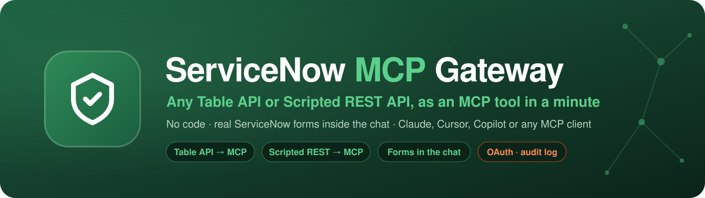

<p align="center">
  
</p>

<p align="center">
  <a href="https://www.npmjs.com/package/servicenow-mcp-gateway"></a>
  
  
  <a href="LICENSE"></a>
</p>

<h1 align="center">ServiceNow MCP Gateway</h1>

<p align="center"><b>Connect Claude, Cursor, Copilot, Gemini CLI, or any MCP client to ServiceNow, with tools you define yourself.</b></p>

<p align="center"><a href="https://yvain13.github.io/Servicenow-mcp-gateway/"><b>Full tour, guides and agent setup skill →</b></a></p>

A local gateway that wraps ServiceNow REST APIs as MCP tools. Point it at your instance, pick or build tools in a web UI, and connect your AI client. Tool edits reach connected clients immediately, no restart.

## Features

- **No-code tools** on any Table API or Scripted REST endpoint, edited live from a web UI.
- **8 ready-made servers**: incidents, changes, problems, CMDB, servers, business rules, script includes, client scripts.
- **MCP Apps**: interactive forms, tables and approval inboxes inside the chat, built from a JSON spec or one HTML file.
- **OAuth sign-in** through ServiceNow's own login (SSO works), so ACLs and approvals apply to the real user.
- **Governance**: write rate limits, a JSON audit log, and a management UI bound to localhost.

## Install

Requires Node.js 20+.

```bash
SN_INSTANCE_URL=https://devXXXXXX.service-now.com SN_USERNAME=... SN_PASSWORD=... npx servicenow-mcp-gateway
```

Open <http://localhost:3001>, pick a server, click **Config snippet**, and paste the config into your client. You can also set the instance in the UI instead of env vars. Run `npx servicenow-mcp-gateway --help` for options.

No instance? Get a free Personal Developer Instance at [developer.servicenow.com](https://developer.servicenow.com).

## Connect a client

Claude Code:

```bash
claude mcp add --transport http incident-mcp http://localhost:7801/mcp
```

Claude Desktop (`claude_desktop_config.json`):

```json
{
  "mcpServers": {
    "incident-mcp": { "command": "npx", "args": ["mcp-remote", "http://localhost:7801/mcp"] }
  }
}
```

Then just ask: "How many P1 incidents are open?", "Open the change form for tonight's DB patch", "Show my pending approvals".

## Develop from source

```bash
git clone https://github.com/yvain13/Servicenow-mcp-gateway.git
cd Servicenow-mcp-gateway
npm install
cp .env.example .env   # add your instance and credentials
npm run dev
```

`npm test` runs the test suite. The [website](https://yvain13.github.io/Servicenow-mcp-gateway/) walks through servers and tools, apps inside the chat, connecting clients, and an agent skill that sets it all up for you.

## License

Free to use, modify and share under the [ServiceNow MCP Gateway Attribution License](LICENSE). If you fork it, ship it, offer it as a service, or show it in a blog, video or talk, credit the author:

> Built with [ServiceNow MCP Gateway](https://github.com/yvain13/Servicenow-mcp-gateway) by **Tushar Mishra**

---

<p align="center">
  Made by <b>Tushar Mishra</b> · <a href="https://www.youtube.com/@AIbyTusharM">AI by Tushar M on YouTube</a><br>
  <sub>ServiceNow is a trademark of ServiceNow, Inc. This project is independent and not affiliated with it.</sub>
</p>
